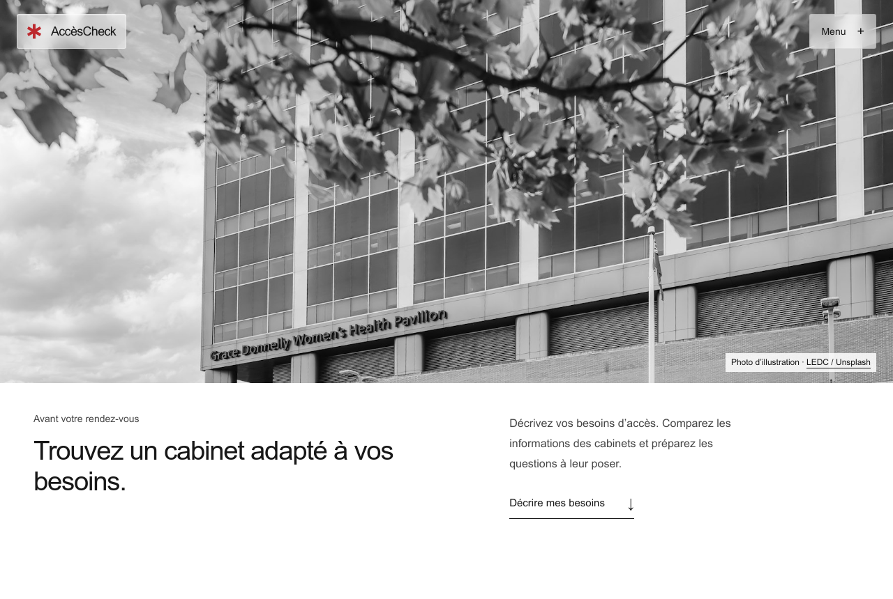
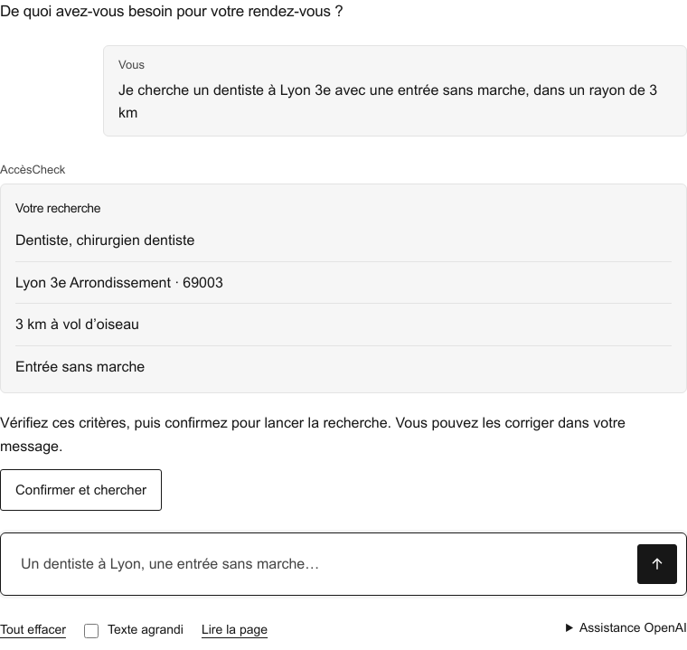
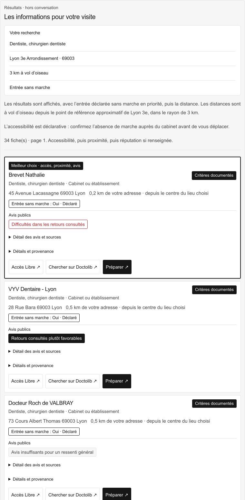
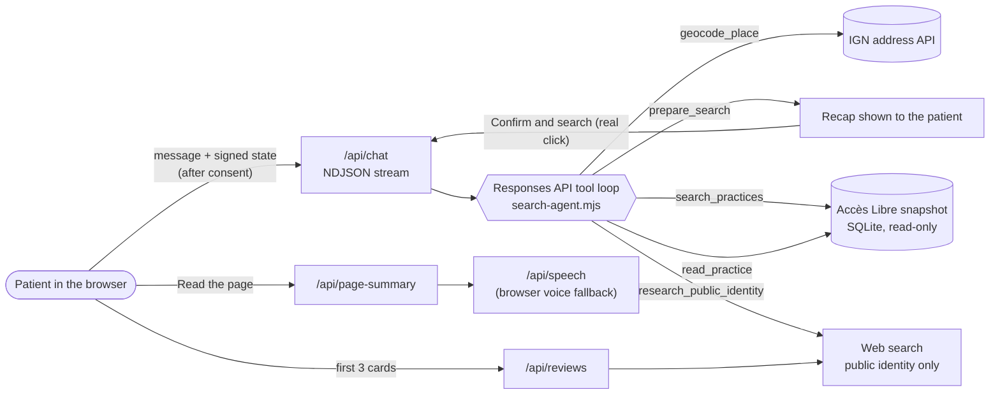

<p align="center">
  
</p>

<h1 align="center">AccèsCheck</h1>

<p align="center">
  Find a medical practice whose entrance you can use, then follow the appointment in large print.<br>
  <b><a href="https://accescheck.vercel.app">accescheck.vercel.app</a></b> · <a href="https://accescheck.vercel.app/?lang=en">English version</a>
</p>



## The problem

You use a wheelchair. You book a dentist online, and on the day you find a step at the entrance.

Booking platforms such as Doctolib show accessibility only when the practitioner fills it in. Many leave it blank. You end up calling practice after practice to ask about the door, the corridor and the toilets.

France already publishes this information. [Accès Libre](https://acceslibre.beta.gouv.fr), run by the Ministry of Ecological Transition, lists entrances, routes and equipment for about 20,000 healthcare facilities. AccèsCheck puts that database behind a conversation.

## Principle

**Your needs first, distance second.** You describe what you need in your own words. An agent turns it into criteria you can check. The server ranks practices on documented access, then distance, then public reviews to break ties.

AccèsCheck never calls a place accessible. Each fact carries its status: _declared_, _unknown_ or _to be confirmed_. Known obstacles leave the list. Missing data stays visible as unknown.

## Demo

▶ **[Watch the demo video](docs/media/demo.mp4)** (under two minutes)

| 1. Describe and confirm                                                                                                  | 2. Compare documented practices                                                                      |
| ------------------------------------------------------------------------------------------------------------------------ | ---------------------------------------------------------------------------------------------------- |
|  |  |

1. Type a request such as _"a dentist in Lyon 3e with a step-free entrance, within 3 km"_.
2. The agent asks only for what is missing, checks the place with IGN (the national mapping agency), and shows a recap. Nothing runs until you click **Confirm and search**.
3. Results open with the **best match**. Chips show each criterion as declared, unknown or a known obstacle. The first three cards get a review sentiment from public sources.
4. **Search on Doctolib** finds the practice's booking page. **Prepare** opens the consultation page in a new tab, where you can follow the visit in large print, type replies and have them read aloud.
5. **Read the page** asks OpenAI for a short spoken summary and reads it. **Larger text** enlarges messages, buttons and cards. The menu switches between French and English.

## Agent architecture



The model chooses its questions and the order of its tools. The server holds every guarantee:

| Tool                       | What the model gets                         | What the server checks                                                                                     |
| -------------------------- | ------------------------------------------- | ---------------------------------------------------------------------------------------------------------- |
| `geocode_place`            | IGN places with signed references           | Coordinates come only from IGN; homonyms trigger a question                                                |
| `prepare_search`           | A recap and a proposal id                   | Profession from the catalogue, valid criteria, verified place; a new proposal cancels the old confirmation |
| `search_practices`         | Ranked practices with evidence              | Runs only after the patient's click on the server button, for the proposal on screen                       |
| `read_practice`            | Evidence, unknowns and sources for one card | The card must come from the verified results                                                               |
| `research_public_identity` | Cited review sources                        | Separate review consent, first page only, one web call per turn                                            |

- **Signed context.** The conversation state lives in the browser tab. The server signs it with an HMAC key and rejects any edit. It expires after one hour.
- **Budgets per turn.** 7 model responses, 8 tool calls, 8,000 output tokens and 55 seconds. The review search stops at 35 seconds and two web calls.
- **Reviews.** The agent reads public review pages, keeps only those that match the practice's name, street and postcode, and summarises welcome, listening, waiting and organisation. Three reviews make an impression; fewer show _not enough reviews_.
- **Models.** Production runs the search agent on `gpt-6.1-sol` (`OPENAI_SEARCH_MODEL`) and reviews, needs and summaries on `gpt-5.4-mini` (`OPENAI_MODEL`, `OPENAI_REVIEW_MODEL`).

Details: [search agent](docs/search-agent.md) · [reviews and reputation](docs/review-reputation.md) · [capability map](CAPABILITY-MAP.md)

## Privacy

- Nothing reaches OpenAI before you tick the consent box. Without it, you can still browse the public directory, which interprets none of your text.
- The app keeps no account, health profile or request log. Your conversation stays in the tab's memory and disappears when you close it.
- The review search sends only the practice's public name and address.
- Do not type your name or contact details: the chat sends your text as written.

## Following the appointment

The consultation page (`/consultation`, French only) helps during the visit:

- **In person:** captions from the device microphone, after you confirm the people present agree.
- **Doctolib or Zoom video:** you share your call's browser tab with its audio. Chrome or Edge 135+ on desktop.
- **Replies:** display them in large print, copy them into the call's chat, or have them read aloud. The app never injects speech into the call.
- **Notes:** drafts copy messages word for word. The app writes no clinical summary.

Captions do not identify speakers. This is not an interpreter or a medical record, and real-call accuracy still needs acceptance testing.

## Run locally

Requires Node.js 24 and an OpenAI key in `.env` for the agent (the public directory works without one).

```sh
npm ci
npm run build
npm run dev          # http://127.0.0.1:4173
```

Sync practice data from the official export with `npm run data:sync`.

## Checks

```sh
npm run check                                    # format, lint, tests, build, artifact
python3 -m unittest discover -s test -p 'test_*.py'
```

Tests use controlled provider replies: they prove the contracts, consent boundaries and tool execution, not the real model's judgement. Browser checks (`scripts/check-*.mjs`) need Playwright and Chrome; see [CONTRIBUTING.md](CONTRIBUTING.md).

## Deployment

A push to `main` runs the checks in GitHub Actions, then deploys to Vercel and tests the public homepage, consultation and search. The Vercel function reads a read-only database snapshot. See [CI/CD](docs/ci-cd.md) and [Vercel](docs/vercel.md).

## Source layout

| Path                                                                                 | Role                                                            |
| ------------------------------------------------------------------------------------ | --------------------------------------------------------------- |
| `src/agents/search-agent.mjs`, `search-contract.mjs`                                 | Tool loop, tool schemas and agent instructions                  |
| `src/agents/review-sources.mjs`, `src/review-core.mjs`                               | Review retrieval, identity matching, sentiment and tie-breaking |
| `src/agents/page-summary.mjs`, `src/speech.mjs`                                      | Spoken page summary and voice                                   |
| `src/geography.mjs`, `src/discovery.mjs`                                             | IGN lookups, Accès Libre access rules and distance              |
| `src/index.html`, `src/assistant.js`, `src/search-results.js`, `src/review-cards.js` | Home page, chat and practice cards                              |
| `src/i18n.js`                                                                        | French to English interface switch                              |
| `src/consultation.html`, `src/companion.js`                                          | Consultation page                                               |
| `src/handler.mjs`                                                                    | HTTP routes and the read-only MCP endpoint `/mcp`               |
| `mcp/`, `prototype/`                                                                 | Local MCP server and fictional consultation workflow            |

Read [AGENTS.md](AGENTS.md) before changing code and [DESIGN.MD](DESIGN.MD) before changing the interface.

## Limits

- Accès Libre data is self-declared and undated per field. A declaration does not guarantee access.
- Only about 10% of records carry a Doctolib profile. For the others, **Search on Doctolib** runs a Google search that may land on the wrong page.
- Review sentiment varies between runs because web search returns different pages.
- The Microsoft Edge voice fails on Vercel; the page then uses the browser's built-in voice.
- No screen-reader, WCAG or clinical acceptance audit has been completed.

Data: Accès Libre, Ministère de la Transition écologique, [Licence Ouverte / Etalab 2.0](https://www.data.gouv.fr/datasets/acceslibre/). Addresses: IGN Géoplateforme. Photo: LEDC / Unsplash.
